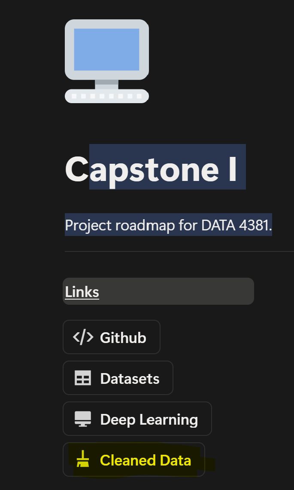
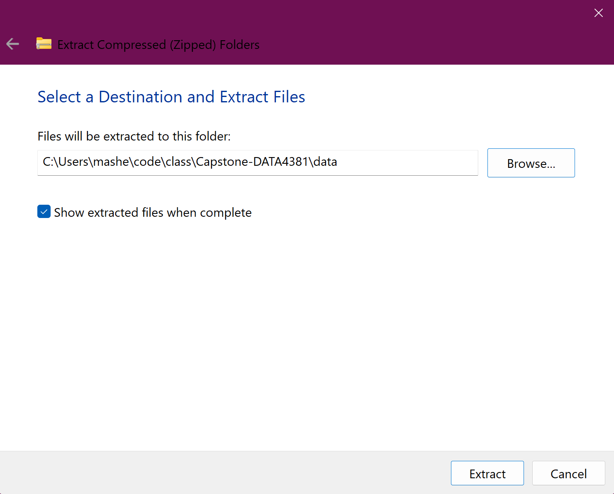
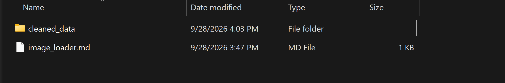
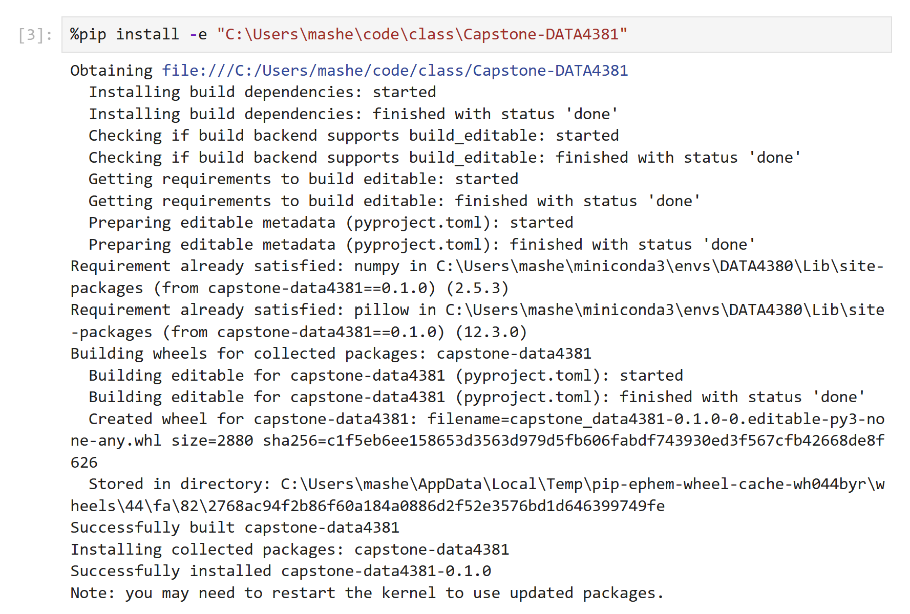
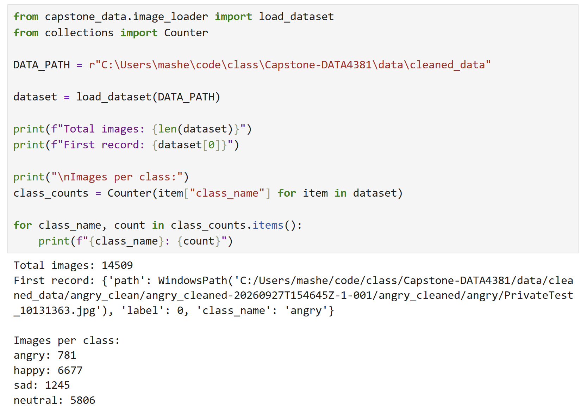

## Image Loader Documentation

Hey ya'll :) Here's how the `image_loader` module works so that our data and
image loading is consistent for the full capstone from here on out.

### 1. Download the cleaned dataset

Download the cleaned dataset files from the shared Notion for the group.

<p align="center">
  
</p>

### 2. Extract the dataset

Unzip the files and place them in a folder on your computer.

I use the local `data/cleaned_data/` folder inside the GitHub repository,
but the cleaned dataset can live anywhere on your machine.

<div style="display: flex; justify-content: space-between; align-items: center;">
  
  
</div>

The cleaned dataset folder should contain:

```text
cleaned_data/
├── angry_cleaned/
├── happy_cleaned/
├── neutral_cleaned/
└── sad_cleaned/
```

### 3. Install the shared package

After cloning the GitHub repository, open a command line and navigate to the
root of the repository.

Activate whichever Python environment you plan to use for the project.

Then run:

```cmd
python -m pip install -e .
```

The `-e` installs the package in editable mode.

This means the package points directly to the code in your local repository.
When you pull updates from GitHub, you normally do not need to reinstall the
package.

### 4. Jupyter users

<p align="center">
  

If you are using Jupyter, make sure your notebook is using the same Python
environment where you installed the package.

You can check which Python your notebook is using with:

```python
import sys

print(sys.executable)
```

### 5. Load the dataset

From any Python script or Jupyter notebook:

<p align="center">
  


```python
from capstone_data.image_loader import load_dataset

dataset = load_dataset(
    r"C:\path\to\your\cleaned_data"
)
```

For example, if you placed the dataset inside the cloned repository:

```python
dataset = load_dataset(
    r"C:\Users\YourName\code\Capstone-DATA4381\data\cleaned_data"
)
```

### 6. Verify that it loaded

You can test the loader with:

```python
print(f"Total images: {len(dataset)}")
print(dataset[0])
```

Each image is represented by a dictionary containing:

```python
{
    "path": image_path,
    "label": numeric_label,
    "class_name": class_name
}
```

The class labels are:

| Class | Label |
|---|---:|
| angry | 0 |
| happy | 1 |
| sad | 2 |
| neutral | 3 |

If the dataset loads and you see image records, you're ready to go!
